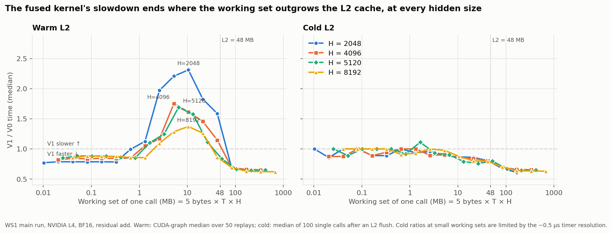
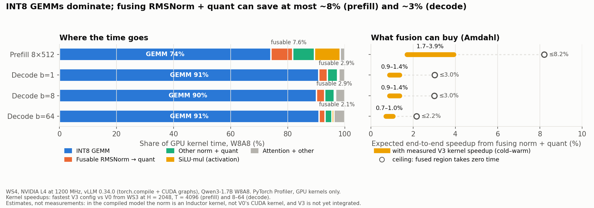

# Why Is Fused RMSNorm + INT8 Quantization Slow?

**Diagnosing a kernel-fusion gap in vLLM across GPU generations**

COMS 6998 High-Performance Machine Learning · Columbia University · Fall 2026

| Team member | UNI |
|---|---|
| Nrushad Joshi | naj2139 |
| Akriti Agarwal | aa5807 |
| Anisha Gupta | ag5213 |
| Toshini Agrawal | ta2828 |

---

## Overview

We study W8A8 inference in vLLM: INT8 weights, plus INT8 activations quantized per token at runtime. In this setup, every transformer layer runs **RMSNorm** and then **INT8 quantization** before the attention (QKV) projection and before the MLP gate/up projections. Both steps are small and limited by memory bandwidth. Fusing them into one kernel should remove the intermediate normalized tensor and cut global-memory traffic, while still producing the residual update, the INT8 output and the per-token scales.

vLLM currently has two problems here:

1. **No INT8 fusion.** vLLM's `torch.compile` fusion pass has RMSNorm + quant patterns for FP8 and NVFP4, but none for INT8. W8A8 INT8 models never get this fusion.
2. **The existing fused kernel is slower at prefill.** vLLM's fused CUDA kernel `rms_norm_dynamic_per_token_quant` beats the unfused pair at decode sizes. At prefill sizes it is up to **2× slower**: 48.6 µs vs. 24.6 µs at 4,096 tokens with hidden size 2048 on an RTX 4090 ([vLLM #60499](https://github.com/vllm-project/vllm/issues/60499)). The issue does not explain why; our findings below do.

This project takes a profile-first approach: reproduce the slowdown on an NVIDIA L4 GPU (Google Cloud), diagnose it with Nsight Compute, write our own fused Triton kernel, and bound the end-to-end gain in vLLM with Amdahl's Law. Kernel-level and end-to-end results are always reported separately.

## Implementations compared

| ID | Implementation |
|---|---|
| V0 | Unfused pair: `fused_add_rms_norm`, then `scaled_int8_quant` |
| V1 | vLLM's fused CUDA kernel (`rms_norm_dynamic_per_token_quant`) |
| V2 | The team's baseline Triton kernel (one row per program), built into `baseline-benchmark/bench_rmsnorm_int8.py`. The issue author's kernel ([AshrithaG/int8-linear](https://github.com/AshrithaG/int8-linear)) can be benchmarked in its place with `--v2-impl` |
| V3 | Our fused Triton kernel (WS3), in seven configurations: rows per program, warps per row, persistent grid |

## Findings (NVIDIA L4, midpoint)

Kernel numbers are BF16 with residual add and a warm L2 unless stated.

**1. The fused kernel is slow only while its data sits in L2.** V1 takes 2.1–2.3× as long as V0 at H = 2048, T = 1024–2048. Once the working set (about 5 bytes × T × H) passes the L4's 48 MB L2, V1 is faster (0.62–0.69× V0's time), and with a cold L2 it is never meaningfully slower. This reproduces the issue's 2× slowdown, but as a cache effect at medium token counts, not a large-token problem. A 200-sample rerun kept 31 of 32 ratios on the same side of 1. ([WS1](baseline-benchmark/results/l4_20261121/README.md), [rerun](baseline-benchmark/results/l4_nearL2/README.md))



**2. The cause is execution overhead, not memory traffic.** Where V1 is slow, it moves about 35% fewer bytes than V0, but it executes 2.3× the instructions, uses half-width loads (~8 B vs. 16 B per thread), runs 1024-thread blocks that cap occupancy at 66.7%, and stalls mostly at block-wide barriers. On the roofline, V1 reaches 20–31% of the L2 bandwidth where V0 reaches 73–93%. ([WS2](<gpu profling - bottleneck/results/l4_20261121/README.md>))

**3. A plain Triton kernel avoids the problem; our tuning did not improve on it.** V3 is 1.3–2.0× faster than V0 and up to 5.3× faster than V1, and passed 880/880 correctness and 364/364 edge-case checks. It matches the baseline Triton kernel V2 but does not beat it. The fixes the WS2 profile suggested (fewer warps per row, several rows per program, a persistent grid) make Triton 5–25% slower. ([WS3](triton-v3/results/l4_part3/README.md))

**4. End to end, fusion can gain only a few percent.** In vLLM 0.34.0 with Qwen3-1.7B W8A8, INT8 GEMMs take 74–91% of GPU time. The RMSNorm → quant pairs a fused kernel can replace are 7.6% of prefill time and 2.1–2.9% of decode time. With V3's measured kernel speedups, that gives about **1.7–3.9% (prefill)** and **0.7–1.4% (decode)**; even a fused region that took zero time would give at most 8.2% and 3.0%. vLLM also still launches 112 separate INT8 quant kernels per prefill, because its fusion pass has no INT8 pattern. ([WS4](part4_results_20261122_004608/README.md))



**5. W8A8 itself pays off.** W8A8 is 1.30–1.34× faster than BF16 at prefill and 1.20–1.42× at decode. WikiText-2 perplexity is 16.40 (W8A8) vs. 16.70 (BF16); see the caveats.

### Hypotheses from the proposal

| Hypothesis | Verdict |
|---|---|
| **H1:** at large token counts, the fused kernel is limited by how it moves data | **Contradicted as stated.** It is slow at medium token counts with a warm L2, and faster at large ones. The cause is instructions, narrow loads, occupancy and barriers. |
| **H2:** whether the intermediate tensor stays in L2 shifts the break-even point | **Supported on the L4.** The slowdown ends where the working set outgrows the 48 MB L2. The test on a small-L2 GPU is still to do. |
| **H3:** break-even points depend on the GPU architecture | **Open.** Needs the other GPUs. |
| **H4:** end-to-end gains are much smaller than kernel gains | **Supported.** Kernel gains of 1.5–2× shrink to a few percent end to end. |

**Caveats:** V2 is our built-in Triton kernel, not yet the issue author's. The WS1 timings ran at 2040 MHz, where the L4 hits its power cap; WS3 and WS4 used a 1200 MHz lock. W8A8 perplexity (16.40) is lower than BF16 (16.70); both checkpoints come from the same model (the W8A8 one is quantized from Qwen/Qwen3-1.7B), so the 1.8% difference is not a model mismatch; it may come from the quantization calibration data. We report both values and make no accuracy-gain claim. The end-to-end gains above are Amdahl estimates: V3 is not yet integrated into vLLM.

## Next steps

- **Integrate V3 into vLLM** and measure the real end-to-end gain against the Amdahl estimate: first as a plugin with layer-level fusion, then as an INT8 pattern in vLLM's fusion pass ([integration proposal](vllm-evaluation/INTEGRATION_PROPOSAL.md)).
- **Run on other GPUs** (A6000 with a 6 MB L2, L40S) to test H2 and H3.
- **Benchmark the issue author's Triton kernel** as V2.
- **Profile V2/V3 with the WS2 toolkit** to explain why Triton avoids V1's overhead, and the bimodal Triton timings at 16 MB activations.

## Methodology

We follow a **benchmark → profile → change → re-benchmark** loop and change one thing at a time.

**Kernel-level and end-to-end numbers are always reported and labeled separately.** A kernel speedup is never presented as an end-to-end speedup.

### Timing protocols (reported separately)

- **Warm cache:** median time over CUDA-graph replays after warm-up.
- **Cold cache:** before every call, write a buffer of at least 8 × L2 (384 MB on the L4) to evict L2, then time that single call. The eviction is outside the timed region. In Nsight Compute, cold means `--cache-control all` (caches flushed before each replay pass).

We confirm cache state with measured L2 hit rates and DRAM traffic rather than inferring it from buffer sizes.

### Metrics

Saved as CSV and JSON in each workstream's `results/` folder, and on the [Weights & Biases dashboard](https://forge.coreweave.com/wandb/ta2828-columbia-university/hpml-int8):


- Time per call (µs)
- Three bandwidth figures, kept separate:
  - minimum required bytes ÷ time (input, residual in and out, norm weights, INT8 output, scales)
  - actual DRAM bytes ÷ time
  - L2 traffic and hit rate
- Occupancy and warp-stall reasons (Nsight Compute)
- Prefill tokens/s and time per output token
- INT8 mismatch rate and WikiText-2 perplexity
- BF16 vs. W8A8 INT8 inference speed and perplexity, and fusion speedups measured against the unfused INT8 baseline

## Setup

- **Hardware:** NVIDIA L4 on Google Cloud Platform (Ada, sm_89; 24 GB GDDR6, ~300 GB/s, 48 MB L2, 58 SMs, 72 W power limit). It has the same architecture as the RTX 4090 in vLLM #60499, so the kernel code paths match, but its memory bandwidth is about 3× lower. We therefore compare fused/unfused ratios and break-even token counts with the issue, not absolute µs. Roofline and %-of-peak figures use the L4's own peak bandwidth. The L4 is power-limited (72 W): at its 2040 MHz boost clock it hits the power cap under load, so clock locks at 2040 MHz do not hold. Runs log the SM clock and power; the steadiest timings come from a clock below the power limit (1200 MHz, used for WS3 and WS4). All variants are compared on the same GPU. Other generations (e.g. A6000 sm_86, L40S sm_89, H100 sm_90) are added for cross-GPU comparison if available.
- **Software:** vLLM 0.34.0, PyTorch 2.14.0 (CUDA 13.0 build), Triton 3.8.0, Python 3.13; PyTorch Profiler, Nsight Systems 2025.6, Nsight Compute 2026.1. Results dashboard: [Weights & Biases](https://forge.coreweave.com/wandb/ta2828-columbia-university/hpml-int8), uploaded with `python wandb_upload.py`.
- **Models:** the Qwen3-1.7B W8A8 INT8 checkpoint used in vLLM #60499 ([`nytopop/Qwen3-1.7B.w8a8`](https://huggingface.co/nytopop/Qwen3-1.7B.w8a8)), so our results are directly comparable, and the BF16 model ([`Qwen/Qwen3-1.7B`](https://huggingface.co/Qwen/Qwen3-1.7B)) for the precision comparison. Secondary, if compatible and time allows: an 8B-class W8A8 model with hidden size 4096 (e.g. Llama-3.1-8B-Instruct-quantized.w8a8).
- **Workloads:** offline, non-concurrent runs.
  - Prefill: 8 prompts of 512 tokens, and 1 prompt of 2,048 tokens.
  - Decode: batch sizes 1, 8 and 64, with 128-token prompts and 128 output tokens.
  - We make no claims about concurrent serving.
- **Accuracy:** WikiText-2 perplexity.

## Challenges

- **Numerical correctness:** INT8 rounding and clamping differ slightly between implementations (the issue saw 0.2–1.1% of values differ by ≤2 steps). One INT8 step also means a different real error for each token, depending on its scale. So we check scales and dequantized error, not only the INT8 codes.
- **Fair baselines:** Every implementation must do identical work: same inputs, residual update, INT8 output, scales and in-place behavior. In-place kernels need fresh inputs on every call, which can bias timings, so we re-validate the issue's timing method instead of reusing it.
- **Cache-aware timing:** Repeated calls on the same input keep data in L2 (the L4's 48 MB L2 can hold a whole 16 MB activation), which inflates bandwidth. Flushing L2 inside CUDA-graph replay would distort the workload, so we use the two separate timing protocols above.
- **Integration:** vLLM has no INT8 fusion pattern, so end-to-end runs require patching the model's norm-to-linear path. This is the riskiest step: the hooks are mapped and an approach is proposed, but V3 is not integrated yet.

## Limits of this study

Results cover one operation, one serving system, one main model and up to three NVIDIA GPUs. Related vLLM work ([#60224](https://github.com/vllm-project/vllm/pull/60224), [#45364](https://github.com/vllm-project/vllm/pull/45364)) and a similar planned kernel ([TileOPs #2392](https://github.com/tile-ai/TileOPs/issues/2392)) may change the baseline. End-to-end gains are small (at most ~8% on this model and GPU). The diagnosis stands even if our kernel does not win.

## Repository structure

```
.
├── README.md                         project overview and guide (this file)
├── wandb_upload.py                   uploads results to the W&B dashboard
├── baseline-benchmark/               WS1: baseline benchmark of V0/V1/V2 (code + results/)
├── gpu profling - bottleneck/        WS2: Nsight Compute / Systems profiling (code + results/)
├── triton-v3/                        WS3: our fused Triton kernel V3 (code + results/)
├── vllm-evaluation/                  WS4: end-to-end vLLM evaluation code and integration proposal
└── part4_results_20261122_004608/    WS4: end-to-end results on the L4
```

Each workstream folder has its own README with the file list, how to run it, and its results. Outputs of new runs are gitignored; finished runs are archived under each workstream's `results/` folder (WS4's in `part4_results_20261122_004608/`).

### Where to start

| If you want to… | Read or run |
|---|---|
| Understand the problem and what we found | [Overview](#overview), [Findings](#findings-nvidia-l4-midpoint), [Next steps](#next-steps) above |
| See the kernel-level numbers | [WS1 main-run write-up](baseline-benchmark/results/l4_20261121/README.md) |
| See why V1 is slow | [WS2 bottleneck analysis](<gpu profling - bottleneck/results/l4_20261121/README.md>) |
| See our fused kernel (V3) results | [WS3 findings](triton-v3/results/l4_part3/README.md) |
| See the end-to-end results | [WS4 findings](part4_results_20261122_004608/README.md) |
| Rerun the V3 benchmark | `cd triton-v3 && bash run_part3_l4.sh` (`QUICK=1` for a smoke test; see its [README](triton-v3/README.md)) |
| Rerun the kernel benchmark | `cd baseline-benchmark && VLLM_VERSION=0.34.0 bash run_l4.sh` (`--quick` for a smoke test; see its [README](baseline-benchmark/README.md)) |
| Rerun the profiling | `cd "gpu profling - bottleneck" && bash run_l4_vm.sh` (see its [README](<gpu profling - bottleneck/README.md>)) |
| Run the end-to-end evaluation | `cd vllm-evaluation && bash run_l4_vm.sh` (`QUICK=1` for a smoke test; reuses the Part 1 venv. See its [README](vllm-evaluation/README.md)) |
| Regenerate plots from committed data (no GPU) | `python baseline-benchmark/plot_l2_crossover.py baseline-benchmark/results/l4_20261121`, `python "gpu profling - bottleneck/analysis/make_plots.py"`, `python "gpu profling - bottleneck/analysis/make_roofline.py"`, `python triton-v3/plot_results.py triton-v3/results/l4_part3/bench_results.csv`, `cd vllm-evaluation && python -m vllm_eval.reporting.make_plots ../part4_results_20261122_004608/results` |

### Running on the L4 VM

1. Create a Google Cloud `g2-standard-*` VM (one L4) from a Deep Learning VM image with CUDA, and at least 100 GB of disk.
2. `git clone` this repository on the VM, so the shell scripts keep their Linux line endings.
3. Each workstream's README has the exact setup. The kernel benchmark and the profiling share one vLLM environment; profiling also needs Nsight Compute and Nsight Systems and permission to read GPU counters (run with `sudo`, or set `NVreg_RestrictProfilingToAdminUsers=0`).
4. Stop the VM when done; a stopped VM only costs its disk.

## Key references

- vLLM Issue [#60499](https://github.com/vllm-project/vllm/issues/60499): RMSNorm and INT8 quant are never fused for W8A8 models; the fused kernel is up to 2× slower at prefill (sm_89)
- vLLM [fusion `torch.compile` passes](https://docs.vllm.ai/en/latest/design/fusions/)
- vLLM PRs [#26234](https://github.com/vllm-project/vllm/pull/26234) (vectorized RMSNorm variance read), [#38026](https://github.com/vllm-project/vllm/pull/38026) (Inductor quant fusion), [#45364](https://github.com/vllm-project/vllm/pull/45364) (manual RMSNorm-quant fusion), [#60224](https://github.com/vllm-project/vllm/pull/60224) (vectorized RMSNorm-quant kernel)
- [AshrithaG/int8-linear](https://github.com/AshrithaG/int8-linear): Triton W8A8 INT8 kernels benchmarked against vLLM
- Zhang & Sennrich, *Root Mean Square Layer Normalization*, NeurIPS 2019
- Xiao et al., *SmoothQuant*, ICML 2023
- Dettmers et al., *LLM.int8()*, NeurIPS 2022
- Yao et al., *ZeroQuant*, NeurIPS 2022
- Ivanov et al., *Data Movement Is All You Need*, MLSys 2021
- Lin et al., *QServe*, MLSys 2025
- Kwon et al., *PagedAttention (vLLM)*, SOSP 2023
- Tillet et al., *Triton*, MAPL 2019
- Williams et al., *Roofline*, CACM 2009
