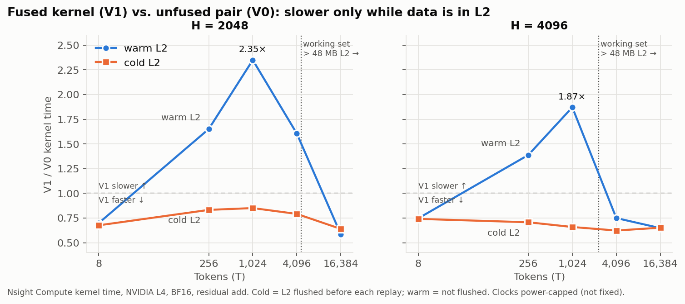
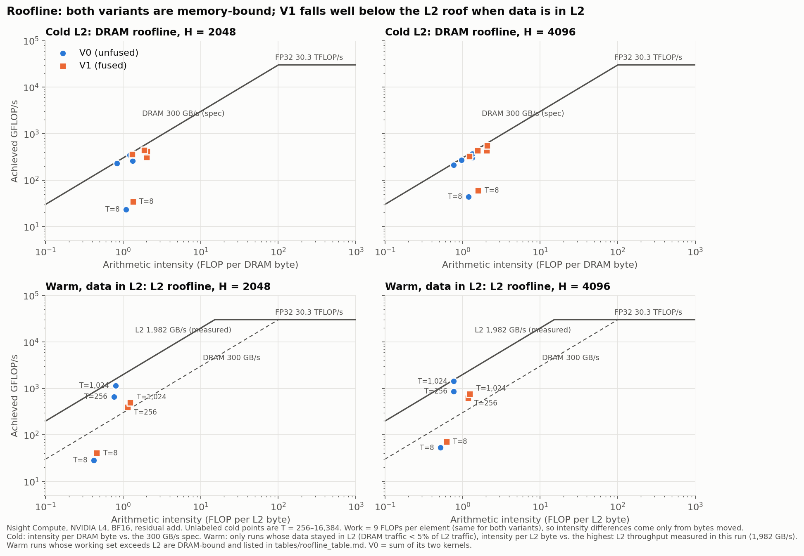

# WS2 results: NVIDIA L4, 2026-11-21

Bottleneck analysis for V0 (unfused `fused_add_rms_norm` → `dynamic_scaled_int8_quant`) vs. V1 (vLLM's fused `rms_norm_dynamic_per_token_quant`), profiled with Nsight Compute and Nsight Systems. This folder covers the three WS2 deliverables: labeled Nsight reports, the memory and execution-resource tables, and the bottleneck analysis below.

## Summary

- **V1 is slower only when the data is already in L2.** With a warm L2 (hit rate 96–99%) at 256–1024 tokens, V1 takes **1.4–2.35×** as long as V0. When data comes from DRAM (cold cache, or working sets larger than the 48 MB L2), V1 is **faster** (0.59–0.85×) because it moves about 35% fewer DRAM bytes.
- **When V1 is slow, it isn't limited by memory.** It moves fewer bytes than V0 even through L2 (15.2 vs. 23.6 MB at H=2048, T=1024) yet takes 2.35× as long. The difference is in execution:
  - about 2.3× the instructions and global-load instructions
  - loads half as wide (~8 B vs. 16 B per thread)
  - 1024-thread blocks that cap occupancy at 2/3 on sm_89
  - block-wide synchronization (`barrier`) as its top stall reason
- These results reproduce Part 1's direction in 17 of 20 configurations; the other 3 are ties within ±10%, not contradictions. Nsight Systems gives the same ratios.

## Plots

Regenerate with `python analysis/make_plots.py results/l4_20261121` and `python analysis/make_roofline.py results/l4_20261121` (both need only matplotlib).

| Plot | What it shows |
|---|---|
| [roofline.png](plots/roofline.png) | Roofline for V0 and V1: DRAM roofline for cold runs, L2 roofline for warm runs whose data stayed in L2 (section 6) |
| [time_ratio_vs_tokens.png](plots/time_ratio_vs_tokens.png) | V1/V0 time vs. tokens, warm and cold: V1 is slower only in warm runs, before the working set outgrows the 48 MB L2 |
| [bytes_v1_vs_v0.png](plots/bytes_v1_vs_v0.png) | V1's DRAM and L2 traffic relative to V0 (0.59–0.67×) at every shape |
| [execution_v0_vs_v1.png](plots/execution_v0_vs_v1.png) | Instructions, load instructions, bytes per load and occupancy at H=2048, T=1024 |
| [ratio_agreement.png](plots/ratio_agreement.png) | V1/V0 from Nsight Compute, Nsight Systems and Part 1, side by side for each shape |

## Setup

| | |
|---|---|
| Hardware | NVIDIA L4 (Ada, sm_89, 58 SMs, 48 MB L2, ~300 GB/s), Google Cloud, driver 620.70.06 |
| Software | vLLM 0.34.0, PyTorch 2.14.0+cu130, CUDA 13.0 (same environment as Part 1); Nsight Compute 2026.1.1, Nsight Systems 2025.6.3 |
| Workload | BF16 activations, residual add on, eps 1e-6, seed 1234; inputs bit-identical to Part 1 (checked by `verify`) |
| Shapes | H ∈ {2048, 4096} × T ∈ {8, 256, 1024, 4096, 16384} |
| Nsight Compute | `--set full` plus extra metrics; 5 warm-up calls, then 3 profiled calls per report (median per kernel); inputs restored before each call, outside the profiled NVTX range |
| Cache modes | `cold` = `--cache-control all` (L2 flushed before each replay pass); `warm` = `--cache-control none` |
| Clocks | `--clock-control none`. The SM clock was not held fixed: the L4 hits its 72 W power cap (see Caveats) |
| Nsight Systems | 5 warm-up calls + 20 timed calls per report, inputs restored between calls (so the L2 is warm) |

**Validity checks**
- Nsight Compute can read the GPU counters (`logs/counters_NVIDIA_L4.log`).
- `verify` passed for all 10 shapes with Part 1's tolerances, on inputs identical to Part 1's (`logs/verify_NVIDIA_L4.log`).

## 1. Time: V1 / V0 (>1 means the fused kernel is slower)

| H | T | Nsight Compute, warm | Nsight Compute, cold | Nsight Systems (warm) | Part 1, warm | Part 1, cold |
|---|---|---|---|---|---|---|
| 2048 | 8 | 0.70 | 0.68 | – | 0.79 | 1.00 |
| 2048 | 256 | **1.65** | 0.83 | – | **1.97** | 0.96 |
| 2048 | 1024 | **2.35** | 0.85 | – | **2.31** | 0.87 |
| 2048 | 4096 | **1.61** | 0.79 | – | **1.59** | 0.81 |
| 2048 | 16384 | 0.59 | 0.64 | 0.61 | 0.66 | 0.61 |
| 4096 | 8 | 0.75 | 0.74 | 0.81 | 0.84 | 0.89 |
| 4096 | 256 | **1.39** | 0.71 | **1.62** | **1.75** | 0.90 |
| 4096 | 1024 | **1.87** | 0.66 | **1.99** | **1.46** | 0.84 |
| 4096 | 4096 | 0.75 | 0.62 | 0.67 | 0.69 | 0.70 |
| 4096 | 16384 | 0.65 | 0.65 | 0.65 | 0.65 | 0.65 |

The three measurement methods agree on which shapes are slow. Exact ratios differ by up to about 20% because the clocks weren't controlled (see Caveats); use them as ranges.

## 2. Memory (`tables/memory_table.md`)

| H | T | cache | V0 time (µs) | V1 time (µs) | V0 DRAM (MB) | V1 DRAM (MB) | V0 L2 (MB) | V1 L2 (MB) | V1 L2 hit % | V1 DRAM % of peak |
|---|---|---|---|---|---|---|---|---|---|---|
| 2048 | 1024 | warm | 16.3 | 38.3 | 0.06 | 0.02 | 23.6 | 15.2 | 98.9 | 0.2 |
| 2048 | 1024 | cold | 53.4 | 45.4 | 14.0 | 9.2 | 23.7 | 15.2 | 44.6 | 67.9 |
| 2048 | 4096 | warm | 104.7 | 168.1 | 24.0 | 32.2 | 93.4 | 59.3 | 71.5 | 63.9 |
| 2048 | 4096 | cold | 217.0 | 171.8 | 61.9 | 40.4 | 93.7 | 59.4 | 43.4 | 78.4 |
| 4096 | 1024 | warm | 26.5 | 49.6 | 0.21 | 0.04 | 48.9 | 30.3 | 99.4 | 0.3 |
| 4096 | 1024 | cold | 103.3 | 68.1 | 28.2 | 18.2 | 49.1 | 30.2 | 44.5 | 89.2 |
| 4096 | 4096 | cold | 556.3 | 346.9 | 155.7 | 96.8 | 198.9 | 118.8 | 43.5 | 92.7 |
| 2048 | 16384 | cold | 1303.2 | 833.9 | 363.5 | 231.2 | 374.8 | 235.9 | 43.1 | 92.6 |

- **V1 always moves fewer bytes than V0:** about 35% less DRAM traffic in cold runs and about 37% less L2 traffic, because it doesn't write and re-read the normalized intermediate tensor.
- **When data is in L2 (warm, T = 1024)**, almost nothing goes to DRAM, yet V1 is still 1.87–2.35× slower. Its time there isn't set by memory traffic.
- **At large T**, both variants run at 88–96% of the L4's DRAM bandwidth, so the fewer bytes win.
- **At the L2 limit (H=2048, T=4096, warm)**, V1's L2 hit rate (71.5%) is lower than V0's quant kernel's (99.9%), and V1 moves more DRAM bytes than V0 (32 vs. 24 MB).

## 3. Execution resources (`tables/execution_table.md`)

| H | T | Instructions V0 / V1 | Global-load instr. V0 / V1 | Bytes per warp load V0 / V1 | Block size V0 / V1 | Occupancy (achieved / theoretical) V0 / V1 | Top V1 stall |
|---|---|---|---|---|---|---|---|
| 2048 | 1024 | 2.79 M / 6.50 M (2.3×) | 57 K / 132 K (2.3×) | 512 (norm) / ~254 | 256 / 1024 | 86–90% of 100% / 62% of 66.7% | barrier |
| 4096 | 1024 | 4.04 M / 8.91 M (2.2×) | 115 K / 263 K (2.3×) | 512 (norm) / ~255 | 256 / 1024 | 87–91% of 100% / 65% of 66.7% | long_scoreboard (cold), barrier (warm) |
| 2048 | 16384 | 44.7 M / 104.0 M (2.3×) | 918 K / 2.11 M (2.3×) | 512 (norm) / ~254 | 256 / 1024 | 92–94% of 100% / 63% of 66.7% | barrier |
| 4096 | 16384 | 64.7 M / 142.5 M (2.2×) | 1.84 M / 4.21 M (2.3×) | 512 (norm) / ~255 | 256 / 1024 | 89–92% of 100% / 65% of 66.7% | barrier |

V0's numbers are summed over its two kernels. V0's norm kernel is `fused_add_rms_norm_kernel<BFloat16, 8, true>`, which reads 8 BF16 values (16 B) per thread per load. Both variants use 30–36 registers per thread.

- **Narrower loads, more instructions.** V1 issues about 2.3× as many global-load instructions, each moving about half as many bytes (~8 B per thread vs. 16 B), and executes about 2.3× the instructions in total for the same work.
- **Its occupancy is capped by its block size.** V1 launches 1,024 threads per block. An sm_89 SM holds at most 1,536 threads, so only one block fits per SM and theoretical occupancy is 66.7%. V0's 256-thread blocks reach 100% theoretical and 86–96% achieved.
- **Synchronization overhead.** V1's top stall reason is `barrier` for every H=2048 shape and for warm H=4096 shapes: warps wait at block-wide `__syncthreads()` across 32 warps, for the row reductions (sum of squares, then the absmax for the scale).

## 4. Hypotheses

| Hypothesis | Verdict on the L4 | Evidence |
|---|---|---|
| **H1:** at large token counts the fused kernel is limited by how it moves data, not by arithmetic or reduction latency | **Partly supported; needs refining** | Where V1 is slow, it isn't bandwidth-limited: it moves fewer bytes, uses 0.2–0.3% of DRAM peak at T=1024, and the data is in L2. It does move data inefficiently (half-width loads, 2.3× load instructions), but block-wide reduction barriers and the 2/3 occupancy cap also contribute, so reduction and synchronization cost can't be ruled out. At the largest T, V1 is *not* slow. The ablations in section 5 are needed to separate the causes. |
| **H2:** whether the intermediate stays in L2 changes where fusion breaks even | **Supported** | V1 is slower only in warm runs where the data fits in L2 (hit rate 96–99%) and never in cold runs (0.62–0.85×). Where the data fits in L2 (T = 256–1024, and H=2048 at T=4096), V0's warm/cold time ratio is 0.26–0.48, while V1's is 0.69–0.98: V0 benefits much more from L2 than V1 does. In Part 1, V1 starts winning exactly where the working set (~5 bytes × H per token) passes 48 MB. |
| **H3:** break-even points depend on the GPU architecture | **Not tested** | Only one GPU (L4) was profiled. |
| **H4:** end-to-end gains are much smaller than kernel gains | **Out of scope for WS2** | Covered by WS4 (`vllm-evaluation/`). |

## 5. Candidate causes to test (for WS3 ablations)

1. **Load width:** 128-bit (16 B) vectorized loads in V1's pattern, as in V0's norm kernel and vLLM PR #26234 / #60224.
2. **Block size and rows per block:** 256-thread blocks, or several rows per 1,024-thread block, to lift the 66.7% occupancy cap.
3. **Reduction cost:** warp-shuffle reductions with fewer block-wide barriers, and computing the sum of squares and the absmax in fewer passes.
4. **Reference point:** Part 1's built-in Triton kernel (V2) is fastest when data is in L2. Profiling it the same way would show which of 1–3 it already avoids.

## 6. Roofline (`plots/roofline.png`, `tables/roofline_table.md`)

**Model.** Both variants do the same arithmetic, about 9 FP32 operations per element (residual add, square, sum, ×rstd, ×weight, abs, max, ÷scale, round), so work is counted analytically as 9 × T × H. Intensity differences between V0 and V1 therefore come only from the bytes each moves, which Nsight Compute measured.

| Roof | Value | Source |
|---|---|---|
| DRAM bandwidth | 300 GB/s | L4 spec (highest measured: 288 GB/s) |
| L2 bandwidth | 1,982 GB/s | Highest L2 throughput measured by any kernel in this run (V0's norm kernel, H=4096, T=1024, warm); NVIDIA does not publish the L4's L2 bandwidth |
| FP32 compute | 30.3 TFLOP/s | L4 spec |

Cold runs are placed on the DRAM roofline. Warm runs are placed on the L2 roofline when their data stayed in L2 (DRAM traffic under 5% of L2 traffic: all T ≤ 1024); warm runs at larger T are DRAM-bound and are measured against the DRAM roof in the table.

**Results** (% of the applicable roof, from `tables/roofline_table.md`):

| Regime | V0 | V1 |
|---|---|---|
| Cold, T = 1024–16384 (DRAM roof) | 87–95% | 68–93% |
| Warm, data in L2, T = 1024 (L2 roof) | **73–93%** | **20–31%** |
| Warm, data in L2, T = 256 (L2 roof) | 44–57% | 18–27% |
| T = 8 (either roof) | 3–12% | 4–12% |

- **Both variants are firmly memory-bound.** Intensity is 0.4–3.2 FLOP per byte, far left of the ridge points (101 FLOP/byte for DRAM, 15 for L2). Compute is never the limit.
- **From DRAM, both run close to the roof.** At T ≥ 1024, V0 reaches 87–95% of DRAM bandwidth and V1 68–93%. V1 sits at higher intensity because it moves fewer bytes, so at the same bandwidth it finishes sooner. That is why it wins cold.
- **From L2, V1 is far below the roof.** At T = 1024, V0 reaches 73–93% of the measured L2 bandwidth, while V1 reaches only 20–31%. The L2 can deliver data about 3–4× faster than V1 consumes it. This is the roofline view of section 3: V1's narrower loads, extra instructions and lower occupancy cap its throughput, and the cap only matters once memory is fast enough to expose it.
- **At T = 8**, both kernels reach under 12% of either roof. With 8 rows there is too little work to fill 58 SMs, so these runs are limited by launch and latency, not bandwidth.

## Caveats

- **Clocks weren't controlled.** Nsight Compute ran with `--clock-control none`, and the L4 is power-capped at 72 W. In the Part 1 rerun's GPU log, the clock was at 2040 MHz in only 26 of 91 samples under load, with the power-cap flag active in 66. Absolute µs values are only approximate; compare variants by ratio. The note "locked 2040 MHz" in `tables/bottleneck_analysis.md` is wrong.
- **The 3 Part 1 "disagreements"** in `tables/part1_vs_ncu.md` are all cold runs at T ≤ 256 where Part 1's ratio is 0.90–1.00. That's inside the ±10% tie zone, and Part 1's single-call cold timings are limited by the 0.5 µs event-timer resolution. No configuration has V1 slower in one source and faster in the other.
- **Some warm runs are slower than cold** (warm/cold 1.08–1.36 at T = 16384, and at H = 4096, T = 4096). This isn't expected and is probably clock variation or dirty L2 lines left by the previous replay pass. Don't use those shapes for cache arguments.
- **DRAM bytes can come out below the theoretical minimum** (for example V1's `dram/min` = 0.69), because some writes are still in L2 when the kernel ends. Compare DRAM bytes between variants rather than against the minimum. One L2 hit rate reads 100.2%, which is a counter artifact.
- **One GPU, one model shape family:** results cover hidden sizes 2048 and 4096 on the L4 only.

## Files

| Path | Contents |
|---|---|
| `tables/memory_table.{md,csv}` | Per-kernel and total time, DRAM and L2 bytes, L2 hit rate, % of DRAM peak, minimum bytes |
| `tables/execution_table.{md,csv}` | Registers, block and grid size, occupancy, instructions, load width, top stalls |
| `tables/bottleneck_analysis.md` | Auto-generated first pass (superseded by this file; see Caveats) |
| `tables/part1_vs_ncu.md` | Part 1 vs. Nsight Compute ratio per shape |
| `nsys/` | Nsight Systems timelines (`.nsys-rep`) and kernel summaries (`.kern_sum.csv`) |
| `ncu/MANIFEST.md` | The 40 Nsight Compute reports (~750 MB, not in git): names, sizes and SHA-256 checksums |
| `plots/` | The four plots above (PNG) |
| `logs/` | One log per pipeline step (counter check, verify, bench, nsys, ncu, parse, analyze) |

Report names follow `<variant>_<gpu>_H<hidden>_T<tokens>_<cold|warm>` (Nsight Systems names have no cache mode).
